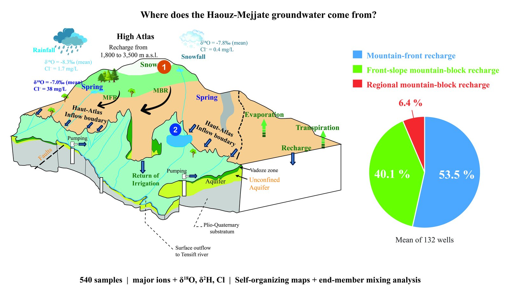

# Recharge Mechanisms from Environmental Tracers (Haouz-Mejjate)

## Overview

**Where does the groundwater of the Haouz-Mejjate aquifer come from, and in what proportions?**
This study, published in *Groundwater for Sustainable Development* (2026), combines major-ion
hydrochemistry, stable isotopes (δ18O, δ2H), self-organizing maps (SOM) and end-member mixing
analysis (EMMA) on 540 water samples to identify the recharge pathways of a semi-arid piedmont
aquifer at the foot of the High Atlas (Morocco), and to quantify their contributions with
uncertainty.

- **Study area:** Haouz-Mejjate aquifer and High Atlas of Marrakech, Morocco
- **Role:** First author (study design, field campaigns, data analysis, modelling, writing)
- **Institutions:** UM6P-IWRI and University of Florence (DAGRI), with co-authors from partner institutions in Morocco and Italy
- **Status:** Published, November 2026 (received 5 June 2026, accepted 4 November 2026)

`Hydrochemistry` `Stable isotopes` `Self-organizing maps` `PCA` `HCA` `EMMA` `Monte Carlo` `Python` `Jupyter`

---

## Highlights

- A multi-tracer framework quantifies recharge in the semi-arid Haouz-Mejjate aquifer.
- SOM clustering identifies four hydrochemical water types from 540 samples.
- Stable isotopes place groundwater recharge at about 1800 to 3500 m a.s.l. in the Atlas.
- EMMA quantifies mountain-front recharge at 53.5 ± 5.2 %, front-slope mountain-block recharge at 40.1 ± 5.3 %, and regional mountain-block recharge at 6.4 ± 0.7 %.
- The SOM-EMMA-isotope framework is transferable to other semi-arid piedmont aquifers.

## Methods in brief

- **Data:** 540 water samples (major ions, δ18O, δ2H) covering the continuum from the High Atlas recharge zones to the Haouz-Mejjate alluvial aquifer, combining new field campaigns with quality-checked published datasets.
- **Classification:** self-organizing maps, cross-validated with principal component analysis and hierarchical clustering, to identify hydrochemical facies objectively.
- **Recharge sources:** stable isotopes to locate recharge elevations; end-member mixing analysis with Monte Carlo uncertainty propagation and sensitivity analysis to quantify the contribution of each pathway.
- **Reproducibility:** ten Jupyter notebooks reproduce every figure of the article, from the raw dataset to the final mixing results.

## Open data and code

The full dataset and analysis code are openly available (code under GPL-3.0, data under CC BY 4.0):

[:fontawesome-brands-github: GitHub repository](https://github.com/ElFarchouni/Haouz-Mejjate-recharge-SOM-EMMA){ .md-button }
[:material-database: Zenodo dataset, DOI 10.5281/zenodo.23419569](https://doi.org/10.5281/zenodo.23419569){ .md-button }

## Publication

El Farchouni, A., Hadri, A., Ait Brahim, Y., Hssaisoune, M., Bouchaou, L., Ouarani, M., Miftah, M., Bouimouass, H., Castelli, G., Bresci, E., Penna, D., Kchikach, A., Fakir, Y. (2026). Groundwater recharge mechanisms in the Haouz-Mejjate aquifer (Morocco): Insights from environmental tracers and self-organizing maps. *Groundwater for Sustainable Development*, 101706.

[Read the article :material-open-in-new:](https://doi.org/10.1016/j.gsd.2026.101706){ .md-button .md-button--primary }
[Back to all projects :material-arrow-left:](index.md){ .md-button }
